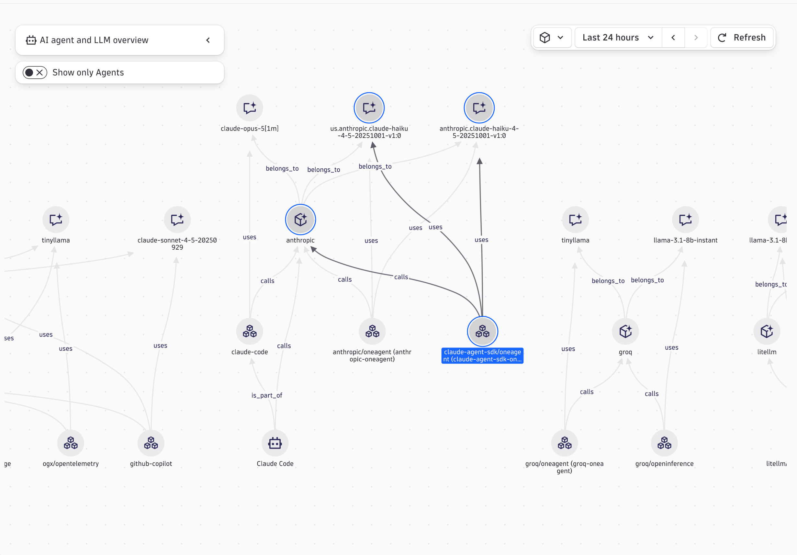
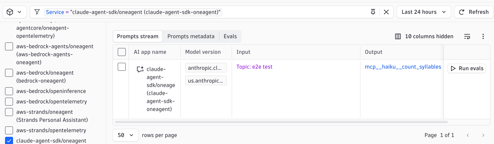

# Claude Agent SDK (Bedrock) + OneAgent Demo

Demonstrates tracing a [Claude Agent SDK](https://pypi.org/project/claude-agent-sdk/) agent with Dynatrace via OneAgent auto-instrumentation. The agent writes a haiku and calls one in-process tool (`count_syllables`) so a tool span appears under the agent span.

## Prerequisites

- Python 3.13+
- AWS credentials (`AWS_ACCESS_KEY_ID`, `AWS_SECRET_ACCESS_KEY`, `AWS_DEFAULT_REGION`)
- Anthropic model access enabled in your AWS account (Bedrock)
- Dynatrace OneAgent 1.349 or later installed on the host

## Enable the OneAgent features

Both features are opt-in. In Dynatrace, go to **Settings** > **OneAgent features** and enable:

1. **Experimental Python GenAI Claude Agent SDK [Opt-In]**: creates the agent and tool spans.
2. **Claude Agent SDK prompt capture [Opt-In]**: adds prompt and response content (`gen_ai.input.messages`, `gen_ai.output.messages`, `gen_ai.system_instructions`) and tool call arguments.

Restart the Python process after changing either feature.

Prompt capture records the full prompt, the model's answer, and tool arguments and results. These can contain sensitive or personal data. Review your data privacy requirements before enabling it.

## How the Claude Agent SDK runs

The SDK does not call the model API itself. It starts the Claude Code CLI as a subprocess and exchanges JSON messages with it. The `claude-agent-sdk` wheel bundles the CLI binary for each platform, so no separate Node.js or Claude Code install is needed, either locally or in the container image.

The demo routes the CLI to Bedrock with `CLAUDE_CODE_USE_BEDROCK=1` and `AWS_REGION` (set from `AWS_DEFAULT_REGION`). The CLI reads the AWS credentials from the environment. It writes session state under `$HOME`, so the container runs as a user with a writable home directory.

## Quick Start

1. Copy `.env.sample` to `.env` and fill in your credentials
2. `make install` (install dependencies)
3. `make run` (start the app on port 8000)
4. `make request` (send a test haiku request, in a second terminal)

## Environment Variables

| Variable | Required | Default | Description |
|----------|----------|---------|-------------|
| `AWS_ACCESS_KEY_ID` | Yes | | AWS access key ID |
| `AWS_SECRET_ACCESS_KEY` | Yes | | AWS secret access key |
| `AWS_DEFAULT_REGION` | No | `us-east-1` | AWS region |
| `ANTHROPIC_MODEL_ID` | No | `us.anthropic.claude-haiku-4-5-20251001-v1:0` | Bedrock model ID |

## Makefile Targets

| Target | Description |
|--------|-------------|
| `make install` | Install Python dependencies |
| `make run` | Run app locally on port 8000 |
| `make build` | Build container image (`APP_IMAGE`, `BUILD_PLATFORM`) |
| `make push` | Build and push image to registry |
| `make request` | POST /haiku to localhost:8000 |
| `make help` | Show all available targets |

## Supported versions

The OneAgent sensor supports `claude-agent-sdk` 0.1.65 and later (tested up to 0.2.153). This demo pins 0.2.153.

## Captured attributes

The sensor instruments `query()` and `ClaudeSDKClient.receive_response()`. Each response turn becomes one agent span:

- `gen_ai.operation.kind` = `agent`
- `gen_ai.provider.name` = `anthropic`
- `gen_ai.request.model`, `gen_ai.response.model`, `gen_ai.response.id`
- `gen_ai.usage.input_tokens`, `gen_ai.usage.output_tokens`
- `gen_ai.response.finish_reasons`

Each tool call becomes a child span with `gen_ai.operation.kind` = `tool` and `gen_ai.tool.name`. With prompt capture enabled, tool spans also carry `gen_ai.tool.call.arguments`.

The SDK talks to a local subprocess, not an HTTP endpoint, so spans have no `server.*` attributes. The demo has no conversation context, so `gen_ai.conversation.id` is not expected.

## Smartscape service entity

OneAgent uses the `FastAPI(title=...)` parameter to assign a Smartscape SERVICE entity. The demo sets a unique title (`claude-agent-sdk-oneagent`) so it gets its own SERVICE (and GENAI_SERVICE) entity.

## Screenshots

The agent and its `count_syllables` tool in Agents topology:

The captured prompt in the Prompts view:

