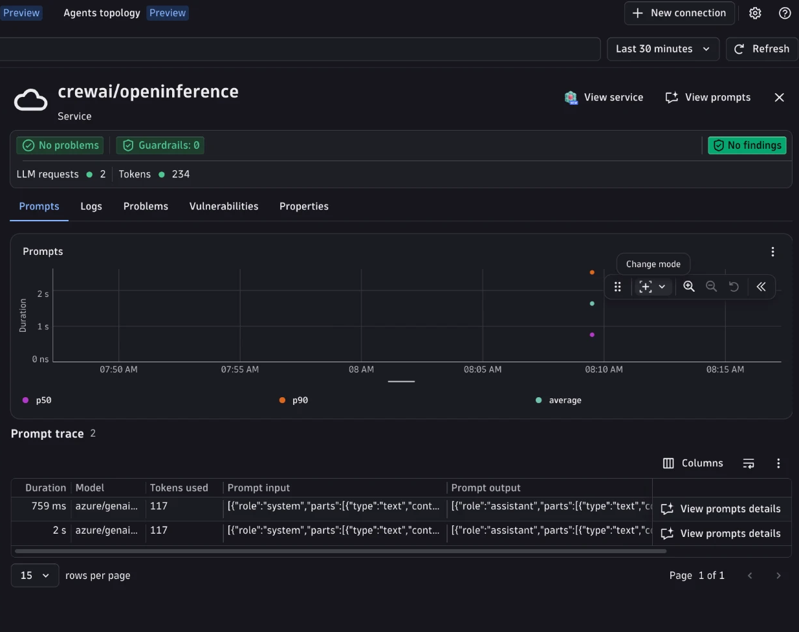

# CrewAI + OpenInference + Dynatrace AI Observability



Instrument a [CrewAI](https://docs.crewai.com/) crew with OpenInference and send traces to Dynatrace AI Observability.
Uses [`openinference-instrumentation-crewai`](https://github.com/Arize-ai/openinference/tree/main/python/instrumentation/openinference-instrumentation-crewai) for crew, agent, and task spans, [`openinference-instrumentation-litellm`](https://github.com/Arize-ai/openinference/tree/main/python/instrumentation/openinference-instrumentation-litellm) for the LLM calls CrewAI makes through LiteLLM, and a [Bindplane OTel collector](https://github.com/Dynatrace/dynatrace-bindplane-otel-collector) to derive GenAI client metrics.

This example enables `OPENINFERENCE_ENABLE_GENAI_SEMCONV=true` (set in `app.py`), so OpenInference emits `gen_ai.*` attributes natively. No downstream OpenInference to `gen_ai.*` normalization is needed. The collector is still used to derive metrics, because OpenInference instrumentors are span-only.

This is the OpenInference counterpart of [`crewai/opentelemetry`](../opentelemetry), which uses OpenLLMetry (Traceloop) instead.

---

## Table of contents

- [What you'll build](#what-youll-build)
- [Prerequisites](#prerequisites)
- [Setup](#setup)
- [Run the example](#run-the-example)
- [Visualize in Dynatrace AI Observability](#visualize-in-dynatrace-ai-observability)
- [How it works](#how-it-works)
- [Troubleshooting](#troubleshooting)

---

## What you'll build

- Runs a FastAPI server exposing `POST /haiku` (accepts a `{"topic": "...", "conversation_id": "..."}` body; `conversation_id` is optional and is returned in the `X-Conversation-Id` response header).
- Kicks off a one-agent CrewAI crew (a "Poet" agent with one task) that calls Azure OpenAI through LiteLLM.
- Produces OpenTelemetry traces with OpenInference, with OTel GenAI `gen_ai.*` attributes emitted natively.
- Routes traces through a local Bindplane collector that forwards them to Dynatrace and derives GenAI client metrics.
- Shows the trace in the Dynatrace AI Observability app with model name, token usage, and message content.

---

## Prerequisites

- A Dynatrace tenant (start a free trial at https://dt-url.net/trial)
- Python 3.10 to 3.13
- [uv](https://docs.astral.sh/uv/getting-started/installation/)
- Docker (to run the Bindplane collector)
- An Azure OpenAI endpoint and key

---

## Setup

### 1. Create a Dynatrace access token

1. In Dynatrace press `Ctrl+K` and search for **Access tokens**.
2. Create a token with these permissions:
   - `openTelemetryTrace.ingest`
   - `metrics.ingest` (for the derived GenAI client metrics)
3. Copy the token value.

### 2. Set environment variables

Copy `.env.sample` to `.env` and fill it in (the Makefile sources it automatically):

```bash
# .env
DT_ENDPOINT=https://abc12345.live.dynatrace.com
DT_API_TOKEN=dt0c01.****.*****

AZURE_OPENAI_ENDPOINT=https://your-resource.openai.azure.com
AZURE_OPENAI_API_KEY=...
OPENAI_API_VERSION=2024-07-01-preview
MODEL=<deployment-name>
```

`MODEL` is the Azure deployment name. A value without a `/` is prefixed with `azure/` for LiteLLM.

### 3. Install dependencies

```bash
make install
```

---

## Run the example

In one terminal, start the collector and server:

```bash
make run
```

In a second terminal, send a two-turn conversation (two requests with the same `conversation_id`):

```bash
make request
```

The server runs on port 8000. `make run` starts a Bindplane collector on port 4318 first, then starts the FastAPI app pointing to it. Traces flow: app, then collector (derives metrics), then Dynatrace.

---

## Visualize in Dynatrace AI Observability

1. In Dynatrace press `Ctrl+K` and search for **AI Observability**.
2. Your haiku request appears in the Explorer tab with model name, token usage, and message content.
3. Open the trace to see the crew, agent, task, and LLM spans.

---


## How it works

`CrewAIInstrumentor` creates spans for the crew kickoff, the agent, and the task. CrewAI calls the model through LiteLLM, so `LiteLLMInstrumentor` adds the LLM span. With `OPENINFERENCE_ENABLE_GENAI_SEMCONV=true`, both instrumentors write OTel `gen_ai.*` attributes alongside the OpenInference ones, including:

- `gen_ai.request.model`
- `gen_ai.provider.name`
- `gen_ai.operation.name`
- `gen_ai.usage.input_tokens` and `gen_ai.usage.output_tokens`
- `gen_ai.input.messages` and `gen_ai.output.messages`
- `gen_ai.request.temperature` (from the `temperature` set on the CrewAI `LLM`)
- `gen_ai.conversation.id`

Requests may include a `conversation_id` (for example, `{"topic": "nature", "conversation_id": "haiku-session-1"}`). Reuse it across turns to group them into one conversation. If omitted, a new UUID is generated; either way it is returned in the `X-Conversation-Id` header. `using_attributes(session_id=...)` propagates it as `session.id` on every span of the turn, which OpenInference also emits as `gen_ai.conversation.id`.

Two attributes are filled outside the instrumentors:

- `gen_ai.system_instructions`: OpenInference leaves the system prompt inside `gen_ai.input.messages`. A small span processor in `app.py` sets it on the LiteLLM span from the agent role, backstory, and goal (the same text CrewAI sends as the system message).
- `gen_ai.response.model`: the LiteLLM instrumentor records only the reply text, so no response model is emitted. A collector `transform` copies `gen_ai.request.model` when the response model is unset.

`OPENINFERENCE_ENABLE_GENAI_SEMCONV` depends on OpenInference package behavior. It is supported by `openinference-instrumentation` 0.1.71, which both instrumentors use.

### Derived metrics

OpenInference is span-only, so the GenAI client metrics are derived from the LLM spans by collector connectors:

| Metric | Derived by |
|---|---|
| `gen_ai.client.operation.duration` (s) | `span_metrics` connector |
| `gen_ai.client.token.usage` (`gen_ai.token.type` = `input`/`output`) | `signal_to_metrics` connector |

Both run on a separate `traces/genai_metrics` pipeline branch with delta temporality, which Dynatrace metric ingest requires.

---

## Troubleshooting

**No spans in Dynatrace:**
- Confirm `DT_ENDPOINT` and `DT_API_TOKEN` are set correctly.
- Check collector logs with `make logs`.

**Spans visible in Distributed Tracing but not AI Observability:**
- AI Observability requires `gen_ai.provider.name` on the span.
- Confirm the collector is running: `docker ps | grep crewai-openinference-otel-collector`.

**Clean up the collector container:**
```bash
make stop
```
