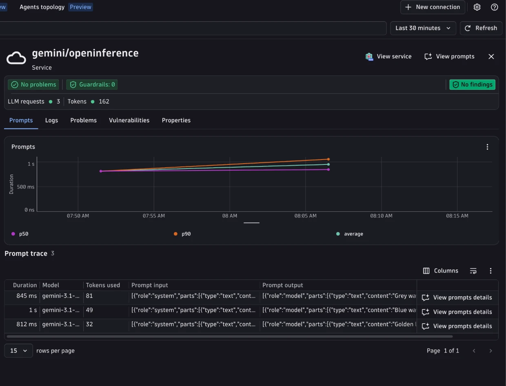

# Gemini + OpenInference + Dynatrace AI Observability



Generate a haiku with Google Gemini through the [`google-genai`](https://pypi.org/project/google-genai/) SDK, send the OpenTelemetry trace to Dynatrace, and see it in the **AI Observability** app.

The app is instrumented with [`openinference-instrumentation-google-genai`](https://github.com/Arize-ai/openinference/tree/main/python/instrumentation/openinference-instrumentation-google-genai). This example sets `OPENINFERENCE_ENABLE_GENAI_SEMCONV=true` in `app.py`, so OpenInference emits `gen_ai.*` attributes natively. No downstream OpenInference to `gen_ai.*` normalization is needed. A local collector is still used to derive metrics, because OpenInference instrumentors are span-only.

---

## Table of contents

- [What you'll build](#what-youll-build)
- [Prerequisites](#prerequisites)
- [Setup](#setup)
- [Run with the Bindplane collector](#run-with-the-bindplane-collector)
- [Visualize in Dynatrace AI Observability](#visualize-in-dynatrace-ai-observability)
- [Attribute reference](#attribute-reference)
- [Metrics](#metrics)
- [Known gaps and limitations](#known-gaps-and-limitations)
- [Troubleshooting](#troubleshooting)

---

## What you'll build

- Calls Gemini (`client.models.generate_content`) for a two-turn haiku conversation with a system prompt and `temperature=0.7`.
- Emits OpenTelemetry spans with native `gen_ai.*` attributes via `GoogleGenAIInstrumentor`.
- Derives `gen_ai.client.operation.duration` and `gen_ai.client.token.usage` from spans in a local collector.
- Shows the trace in the Dynatrace AI Observability app with model, token usage, and message content.

This is a minimal provider example (one model call, no agent framework). For an agent built on Gemini, see [Google ADK](../../google-adk/).

---

## Prerequisites

- A Dynatrace tenant (start a free trial at https://dt-url.net/trial)
- Docker installed and running
- Python 3.11+
- [uv](https://docs.astral.sh/uv/getting-started/installation/)
- A [Gemini API key](https://aistudio.google.com/apikey)

---

## Setup

### 1. Create a Dynatrace access token

1. In Dynatrace press `Ctrl+K` and search for **Access tokens**.
2. Create a token with the `openTelemetryTrace.ingest` permission.
3. Copy the token value.

### 2. Set environment variables

Copy `.env.sample` to `.env` and fill it in (the Makefile sources it automatically):

```bash
# .env
DT_ENDPOINT=https://abc12345.live.dynatrace.com
DT_API_TOKEN=dt0c01.****.*****

GOOGLE_API_KEY=**********************
MODEL=gemini-3.1-flash-lite   # optional, defaults to gemini-3.1-flash-lite
```

> **Note:** `DT_ENDPOINT` is your base tenant URL, not the `/api/v2/otlp` path.

### 3. Install dependencies

```bash
make install
```

---

## Run with the Bindplane collector

```
App (native gen_ai.* spans)  ->  Bindplane collector (metrics)  ->  Dynatrace Grail
```

The app emits `gen_ai.*` spans natively and only sends to `http://localhost:4318`. The [Dynatrace Bindplane Distribution of OpenTelemetry Collector (DBDOT)](https://github.com/Dynatrace/dynatrace-bindplane-otel-collector) does not normalize attributes; it forwards spans and derives the two metrics (see [`otel-collector-config.yaml`](otel-collector-config.yaml)). It also fills `gen_ai.response.model` from `gen_ai.request.model` when missing (see [Known gaps and limitations](#known-gaps-and-limitations)).

```bash
make run    # starts the collector, then runs app.py once
make logs   # tail collector.log
make stop   # stop and remove the collector container
```

Each run is a two-turn conversation. The app prints its `conversation_id`; pass it back to continue the same conversation in a new run:

```bash
make request TOPIC="mountains"
make request TOPIC="mountains" CONVERSATION_ID=<id printed above>
```

---

## Visualize in Dynatrace AI Observability

1. In Dynatrace press `Ctrl+K` and search for **AI Observability**.
2. Your haiku request appears in the Explorer tab, with model, token usage, and cost for the `gemini/openinference` service.
3. Open a prompt trace to inspect the request and response content.

---


## Attribute reference

`OPENINFERENCE_ENABLE_GENAI_SEMCONV=true` makes OpenInference emit the `gen_ai.*` attributes AI Observability uses, including:

- `gen_ai.request.model`
- `gen_ai.provider.name` (`gcp.gen_ai`)
- `gen_ai.operation.name`
- `gen_ai.usage.input_tokens` / `gen_ai.usage.output_tokens`
- `gen_ai.request.temperature` / `gen_ai.request.max_tokens`
- `gen_ai.input.messages` / `gen_ai.output.messages`
- `gen_ai.conversation.id` (from `session.id`, set with `using_session(conversation_id)`)

`gen_ai.system_instructions` is set by a small span processor in `app.py` (see [Known gaps and limitations](#known-gaps-and-limitations)). The original OpenInference attributes remain on the span as emitted by the SDK.

---

## Metrics

OpenInference emits spans only, so the collector derives the metrics the AI Observability app charts from the spans:

| Metric | Collector component |
|---|---|
| `gen_ai.client.operation.duration` (s) | `span_metrics` connector |
| `gen_ai.client.token.usage` (by `gen_ai.token.type` `input`/`output`) | `signal_to_metrics` connector |

Both metrics use delta temporality.

---

## Known gaps and limitations

- **Provider name:** `GoogleGenAIInstrumentor` sets `llm.provider = google` and no `llm.system`, so OpenInference maps it to `gen_ai.provider.name = gcp.gen_ai` (the OTel value for the Google Gen AI SDK when the backend is not known), not `gcp.gemini` or `gcp.vertex_ai`.
- **Response model:** Gemini responses report `model_version` rather than `model`, so OpenInference does not set `gen_ai.response.model`. The collector mirrors `gen_ai.request.model` into it, because the AI Observability app requires it.
- **System instructions:** OpenInference records `GenerateContentConfig.system_instruction` only as the first input message, not as `gen_ai.system_instructions`. `SystemInstructionsSpanProcessor` in `app.py` sets it on the model span as a JSON array of text parts.

---

## Troubleshooting

**No spans in Dynatrace:**
- Confirm `DT_ENDPOINT` and `DT_API_TOKEN` are set and the token has `openTelemetryTrace.ingest`.
- Check collector logs with `make logs`.

**`API key not valid` from Gemini:**
- Confirm `GOOGLE_API_KEY` is set in `.env`. The span is still exported, with error status.

**Spans in Distributed Tracing but not in AI Observability:**
- Confirm `gen_ai.*` attributes are present in the collector debug output. If they are missing, check that `OPENINFERENCE_ENABLE_GENAI_SEMCONV` is not set to `false` in your environment.

**Port conflict:** check `lsof -i :4318`.
