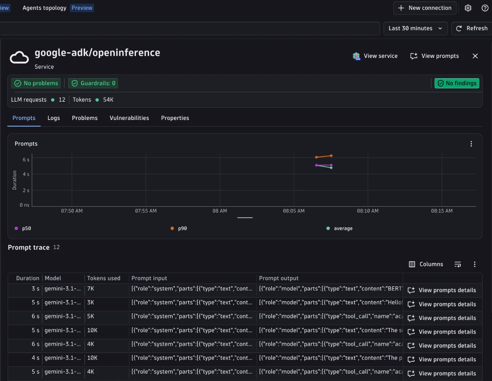

# Google ADK + OpenInference + Dynatrace AI Observability



Instrument a [Google Agent Development Kit (ADK)](https://google.github.io/adk-docs/) agent that runs on Gemini with OpenInference, and send traces to Dynatrace AI Observability.
Uses [`openinference-instrumentation-google-adk`](https://github.com/Arize-ai/openinference/tree/main/python/instrumentation/openinference-instrumentation-google-adk) to auto-instrument ADK, and a [Bindplane OTel collector](https://github.com/Dynatrace/dynatrace-bindplane-otel-collector) to derive metrics.

This example enables `OPENINFERENCE_ENABLE_GENAI_SEMCONV=true`, so OpenInference emits `gen_ai.*` attributes natively. No OpenInference to `gen_ai.*` normalization is needed downstream. The collector is still used to derive metrics, because OpenInference instrumentors are span-only.

For the native ADK OpenTelemetry instrumentation of the same agent, see [`../opentelemetry`](../opentelemetry/).

---

## What you'll build

- Runs a FastAPI server exposing `POST /research` (accepts a `{"topic": "..."}` body).
- Runs the ADK academic research coordinator (`LlmAgent` on Gemini) that delegates to a web search sub-agent and a new research sub-agent through `AgentTool`.
- Produces OpenTelemetry traces with native `gen_ai.*` attributes (agent, LLM, and tool spans).
- Routes traces through a local Bindplane collector that derives `gen_ai.client.operation.duration` and `gen_ai.client.token.usage` metrics from the LLM spans.

---

## Prerequisites

- A Dynatrace tenant (start a free trial at https://dt-url.net/trial)
- Python 3.11+
- [uv](https://docs.astral.sh/uv/getting-started/installation/)
- Docker (to run the Bindplane collector)
- A Gemini API key from [Google AI Studio](https://aistudio.google.com/apikey)

---

## Setup

1. Create a Dynatrace access token with the `openTelemetryTrace.ingest` and `metrics.ingest` scopes.
2. Copy `.env.sample` to `.env` and fill in the values:

   ```bash
   DT_ENDPOINT=https://abc12345.live.dynatrace.com
   DT_API_TOKEN=dt0c01.****.*****
   GOOGLE_API_KEY=...
   MODEL=gemini-3.1-flash-lite
   ```

3. Install dependencies:

   ```bash
   make install
   ```

---

## Run the example

```bash
make run       # starts the collector, then the app on port 8000
make request   # in a second terminal: two POST /research turns in one conversation
make stop      # stop the collector
```

Run `make help` for all targets.

`POST /research` accepts `{"topic": "...", "conversation_id": "..."}`. `conversation_id` is optional: when absent, the app generates a UUID. The response is `{"conversation_id": "...", "answer": "..."}`; send the same `conversation_id` again to continue the conversation.

---

## Visualize in Dynatrace AI Observability

Open the [AI Observability app](https://docs.dynatrace.com/docs/shortlink/app-ai-observability) and filter by service `google-adk/openinference`. Each request shows the agent, LLM, and tool spans with model name, token usage, and message content.

---


## How it works

`app.py` sets `OPENINFERENCE_ENABLE_GENAI_SEMCONV=true` and registers `GoogleADKInstrumentor` before ADK runs, and exports spans over OTLP HTTP to the endpoint in `OTEL_EXPORTER_OTLP_ENDPOINT` (`make run` points it at the local collector).

GenAI attributes and how they are filled:

- `gen_ai.conversation.id`: the request's `conversation_id` is the ADK session id, and `app.py` wraps each turn in OpenInference `using_session`, which OpenInference maps to `gen_ai.conversation.id` on every span of the turn.
- `gen_ai.request.temperature`: each agent sets `GenerateContentConfig(temperature=0.7)` (`genai_config.py`); OpenInference maps it natively.
- `gen_ai.system_instructions`: OpenInference does not set it for ADK (the instruction only appears in the input messages), so a `before_model_callback` in `genai_config.py` sets it on the LLM span from the agent instruction.
- `gen_ai.response.model`: set by the collector, see below.

`otel-collector-config.yaml` does not normalize attributes. It copies `gen_ai.request.model` to `gen_ai.response.model` (ADK responses carry no model field for OpenInference to map), and derives the GenAI client metrics from LLM spans with the `span_metrics` and `signal_to_metrics` connectors.

---

## Troubleshooting

- No traces: confirm the collector is running with `docker ps | grep google-adk-openinference-otel-collector` and check `make logs`.
- Port 4318 already in use: stop any other local collector first.
- `502 agent model error`: Gemini rejected the call (quota, safety, or recitation). The app retries up to three times on a fresh session.
