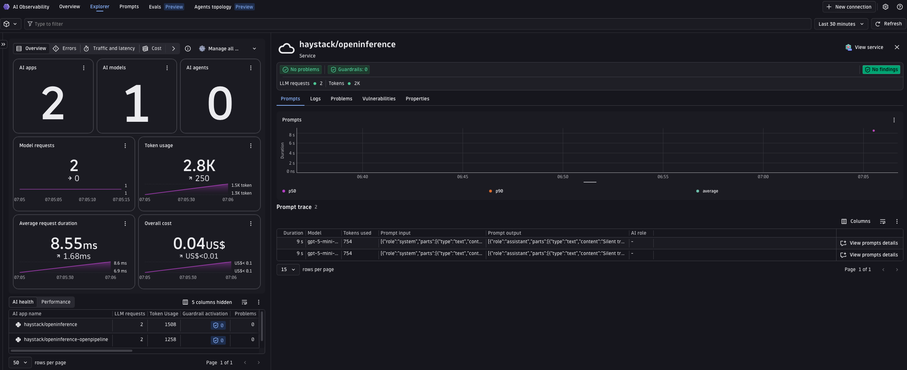
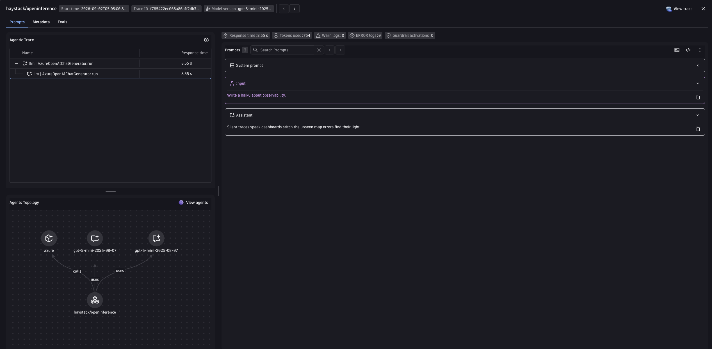

# Haystack + OpenInference Demo

Demonstrates tracing a [Haystack](https://haystack.deepset.ai/) pipeline (Azure OpenAI backend) with Dynatrace via OpenInference instrumentation (`HaystackInstrumentor`).
OpenInference uses its own semantic conventions (`llm.model_name`, `llm.token_count.*`, etc.) This example normalizes them into the Dynatrace `gen_ai.*` format with the Bindplane collector's `gen_ai_normalizer` processor.

---

## Table of contents

- [What you'll build](#what-youll-build)
- [Prerequisites](#prerequisites)
- [Setup](#setup)
- [Run with the Bindplane collector](#run-with-the-bindplane-collector)
- [Visualize in Dynatrace AI Observability](#visualize-in-dynatrace-ai-observability)
- [Attribute mapping reference](#attribute-mapping-reference)
- [Metrics](#metrics)
- [Known gaps & limitations](#known-gaps--limitations)
- [Troubleshooting](#troubleshooting)

---

## What you'll build

- A two-component Haystack `Pipeline` (`ChatPromptBuilder` -> `AzureOpenAIChatGenerator`) that writes a haiku.
- `HaystackInstrumentor` wraps `Pipeline.run` and every component's `run` method directly, producing an OpenInference-shaped trace: one `CHAIN` span for the pipeline and one `LLM` span for the chat generator call.
- Normalizes those OpenInference attributes to Dynatrace `gen_ai.*` format with the Bindplane collector's `gen_ai_normalizer` processor.
- Shows the trace in the Dynatrace AI Observability app with model, token usage, and message content.

Haystack is also demoed via OneAgent auto-instrumentation in [`haystack/oneagent/`](../oneagent/) -- that example instruments the underlying `openai` SDK calls Haystack makes; this one instruments the Haystack pipeline/component layer itself.

---

## Prerequisites

- Python 3.11+
- [uv](https://docs.astral.sh/uv/getting-started/installation/)
- Docker installed and running
- An Azure OpenAI resource (`AZURE_OPENAI_ENDPOINT`, `AZURE_OPENAI_API_KEY`, `AZURE_OPENAI_DEPLOYMENT`)
- Dynatrace tenant with an API token scoped to `openTelemetryTrace.ingest`

---

## Setup

### 1. Create a Dynatrace access token

1. In Dynatrace press `Ctrl+K` and search for **Access tokens**.
2. Create a token with these permissions:
   - `openTelemetryTrace.ingest`
3. Copy the token value.

### 2. Set environment variables

The app and scripts read credentials from environment variables. The easiest way is to create a `.env` file in this directory (the Makefile sources it automatically):

```bash
# .env
DT_ENDPOINT=https://abc12345.live.dynatrace.com
DT_API_TOKEN=dt0c01.****.*****

AZURE_OPENAI_ENDPOINT=https://your-resource.openai.azure.com/
AZURE_OPENAI_API_KEY=**********************
AZURE_OPENAI_DEPLOYMENT=genai-demo                  # optional, defaults to genai-demo
OPENAI_API_VERSION=2024-07-01-preview               # optional, defaults to 2024-07-01-preview
```

> **Note:** `DT_ENDPOINT` is your base tenant URL -- not the `/api/v2/otlp` path. Example: `https://abc12345.live.dynatrace.com`.

### 3. Install dependencies

```bash
make install
```

---

## Run with the Bindplane collector

The [Dynatrace Bindplane Distribution of OpenTelemetry Collector (DBDOT)](https://github.com/Dynatrace/dynatrace-bindplane-otel-collector) intercepts spans and normalizes OpenInference attributes to `gen_ai.*` with its built-in `gen_ai_normalizer` processor before forwarding to Dynatrace. No Dynatrace configuration needed.

```
App  ->  Bindplane collector (gen_ai_normalizer + transform)  ->  Dynatrace Grail
```

This example pins the collector to `ghcr.io/dynatrace/dynatrace-bindplane-otel-collector:1.1.2`. The pin means a future version bump surfaces normalization changes in the e2e test.

The app knows only about `http://localhost:4318` -- it sends spans to the collector, and the collector authenticates with Dynatrace using `DT_ENDPOINT` and `DT_API_TOKEN`.

The pipeline runs two processors (see [`otel-collector-config.yaml`](otel-collector-config.yaml)):

1. **`gen_ai_normalizer`** (source `openinference`, `remove_originals: true`) maps OpenInference attributes to `gen_ai.*`. `remove_originals` drops the raw `llm.*` attributes so exported spans carry only `gen_ai.*` fields.
2. **`transform/response_model`** mirrors `gen_ai.request.model` to `gen_ai.response.model`, which the AI Observability app requires and OpenInference has no separate field for.

### Run it

```bash
# with make (reads .env automatically, starts the collector then runs app.py once)
make run
```

**Useful commands:**

```bash
make logs   # tail collector.log in real time
make stop   # stop and remove the collector container
make request  # re-run the pipeline once against a collector already running
```

---

## Visualize in Dynatrace AI Observability

1. In Dynatrace press `Ctrl+K` and search for **AI Observability**.
2. Your haiku request appears in the Explorer tab, with model, token usage, and cost for the `haystack/openinference` service.
   
3. Open a prompt trace to inspect the request/response content and the agents topology graph.
   

---

## Attribute mapping reference

The collector's `gen_ai_normalizer` (source `openinference`) applies these translations and reconstructs the full conversation from indexed per-message attributes.

| OpenInference source | Dynatrace target |
|---|---|
| `llm.token_count.prompt` | `gen_ai.usage.input_tokens` |
| `llm.token_count.completion` | `gen_ai.usage.output_tokens` |
| `llm.model_name` | `gen_ai.request.model` |
| `llm.provider` (`AzureOpenAIChatGenerator` -> `azure`) | `gen_ai.provider.name` |
| `llm.system` (inferred from the model name) | `gen_ai.provider.name` (fallback, if `llm.provider` is absent) |
| `session.id` | `gen_ai.conversation.id` |
| `openinference.span.kind` | `gen_ai.operation.name` (`LLM` with `llm.model_name` set -> `chat`) / `gen_ai.operation.kind` (`CHAIN` -> `workflow`, else -> `task`) |
| `llm.input_messages.N.*` / `llm.output_messages.N.*` | `gen_ai.input.messages` / `gen_ai.output.messages` |
| _(collector transform)_ | `gen_ai.response.model` (mirrored from `gen_ai.request.model`) |

`session.id` and `user.id` already match the OTel standard and pass through unchanged.

> **Note on the `ChatPromptBuilder` span:** `HaystackInstrumentor` tags the `ChatPromptBuilder` component's span as `openinference.span.kind == "LLM"` too (it only sets `llm.prompt_template.*`, never `llm.model_name` / `llm.token_count.*`). The collector keys its LLM-call logic off `isNotNull(llm.token_count.total) OR isNotNull(llm.model_name)` rather than span kind, so the prompt-builder span is correctly excluded from the `chat` operation mapping.

> **Note on request parameters:** unlike the Cohere/Groq/Mistral OpenInference examples in this repo, `HaystackInstrumentor` never emits `llm.invocation_parameters` for a chat generator's span (only for its embedder spans, which this demo does not exercise) — there is no `gen_ai.request.temperature` / `top_p` / `max_tokens` source to map here at all.

---

## Metrics

OpenInference is span-only by design (its instrumentors emit no metric instruments), so the two metrics the AI Observability app charts must be derived from the spans. The collector does this, so the cost and latency tiles populate:

| Metric | Collector |
|---|---|
| `gen_ai.client.operation.duration` (s) | `span_metrics` connector, on LLM spans |
| `gen_ai.client.token.usage` (`gen_ai.token.type` = `input`/`output`) | `signal_to_metrics` connector, two sum defs |

It reads the normalized `gen_ai.usage.input_tokens` / `gen_ai.usage.output_tokens` (mapped from OpenInference's `llm.token_count.*`). Both metrics use delta temporality -- Dynatrace rejects cumulative.

---

## Known gaps & limitations

### Attributes gen_ai_normalizer does not yet map

The `gen_ai_normalizer` `openinference` source does not set the following attributes. They are optional for the AI Observability app, and are candidates for upstream contribution to the processor:

- `gen_ai.response.finish_reasons` -- moot here anyway, since `HaystackInstrumentor` never captures a finish-reason span attribute in the first place (see [Attribute mapping reference](#attribute-mapping-reference)).

Request parameters (`gen_ai.request.temperature` / `top_p` / `max_tokens`) and prompt caching (`gen_ai.prompt_caching` / `gen_ai.cache.type`) are not applicable here -- `HaystackInstrumentor` does not capture either for chat generator spans.

---

## Troubleshooting

**No spans in Dynatrace:**
- Confirm `DT_ENDPOINT` and `DT_API_TOKEN` are correctly set.
- Confirm the token has `openTelemetryTrace.ingest` permission.
- Check collector logs with `make logs` or `docker logs bindplane-otel-collector`.

**Collector crashes on startup:**
- Run `docker ps -a` and `docker logs bindplane-otel-collector` to see the error.
- Confirm Docker is running and port `4318` is free: `lsof -i :4318`.

**Spans visible in Distributed Tracing but not in AI Observability:**
- AI Observability requires `gen_ai.provider.name` (or `gen_ai.system`) to be set on the span.
- Confirm the `gen_ai_normalizer` processor ran -- the raw `llm.*` attributes should be gone and `gen_ai.*` attributes present in the collector debug output (`make logs`).

**Port conflict:**
- Ensure nothing else is listening on `4318`: `lsof -i :4318`.
