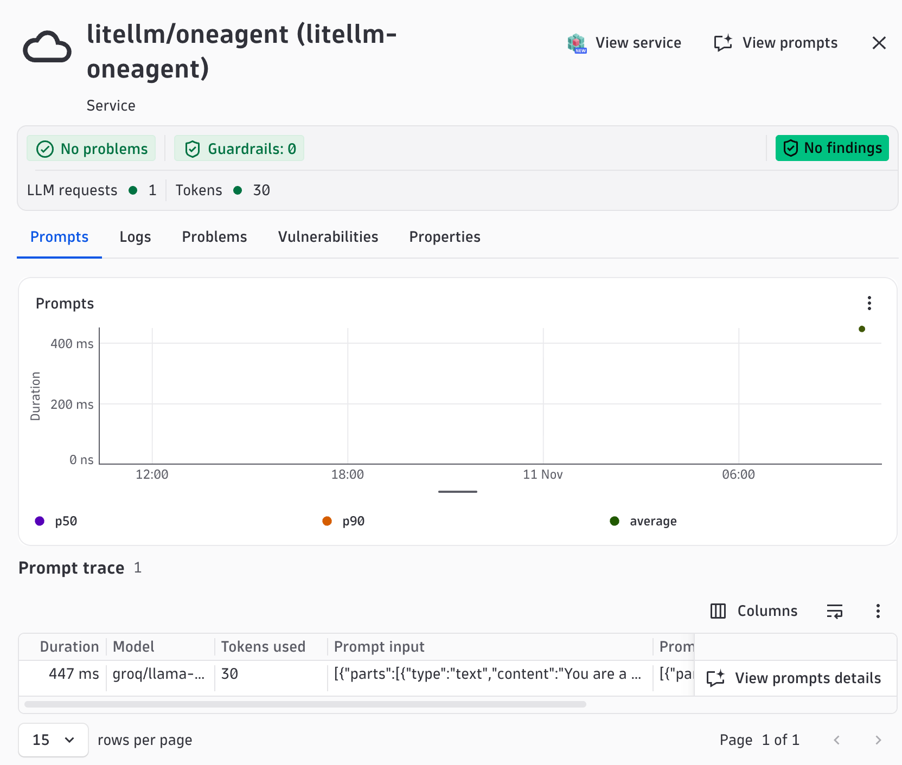
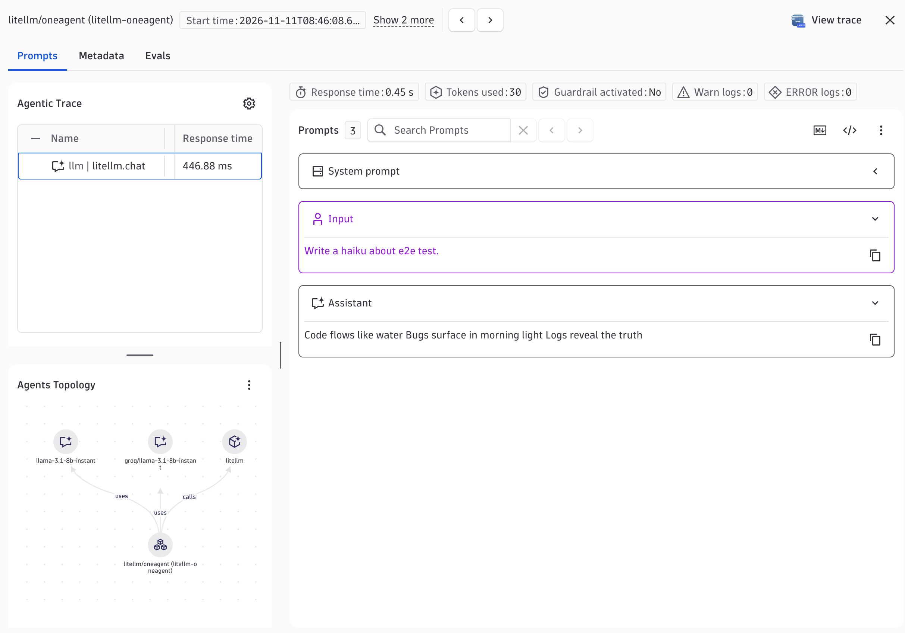

# LiteLLM + OneAgent Demo

Demonstrates tracing LiteLLM SDK calls with Dynatrace via OneAgent auto-instrumentation. LiteLLM routes the request to Groq (`groq/<model>`), the same backend the [OpenTelemetry demo](../opentelemetry/) uses.

> **Experimental sensor.** LiteLLM support in OneAgent is experimental and opt-in.

## Prerequisites

- Python 3.11+
- [uv](https://docs.astral.sh/uv/getting-started/installation/)
- Groq API key (`GROQ_API_KEY`)
- Dynatrace OneAgent 1.351 or later installed on the host
- `litellm` 1.67.0 or later (the demo pins 1.109.0)

## Enable the OneAgent features

In Dynatrace, go to **Settings** > **Preferences** > **OneAgent features** and turn on:

1. **Experimental Python GenAI LiteLLM [Opt-In]** (creates the LiteLLM spans)
2. **LiteLLM prompt capture [Opt-In]** (adds prompt and response content to the spans)

Restart the Python process after changing either feature.

Prompts and responses may contain sensitive data (personal data, secrets, customer content). Review your data privacy requirements before enabling prompt capture.

## Quick Start

1. Copy `.env.sample` to `.env` and fill in your credentials
2. `make install` (install dependencies)
3. `make run` (start the app on port 8000)
4. `make request` (send a test haiku request in a second terminal)

## Environment Variables

| Variable | Required | Default | Description |
|----------|----------|---------|-------------|
| `GROQ_API_KEY` | Yes | | Groq API key |
| `GROQ_API_BASE` | No | Groq default | Override the Groq endpoint (for example an OpenAI-compatible mock) |
| `MODEL` | No | `llama-3.1-8b-instant` | Groq model; the app sends it as `groq/<MODEL>` |

## Makefile Targets

| Target | Description |
|--------|-------------|
| `make install` | Install Python dependencies |
| `make run` | Run app locally on port 8000 |
| `make build` | Build container image (`APP_IMAGE`, `BUILD_PLATFORM`) |
| `make push` | Build and push image to registry |
| `make request` | POST /haiku to localhost:8000 |
| `make help` | Show all available targets |

## Captured attributes

The sensor wraps `litellm.completion` / `acompletion` (plus embeddings, responses and text completion). On chat spans it sets:

- `gen_ai.provider.name` = `litellm`, `gen_ai.operation.name` = `chat`
- `gen_ai.request.model` (the LiteLLM model string, for example `groq/llama-3.1-8b-instant`), `gen_ai.request.max_tokens`, `gen_ai.request.temperature`
- `gen_ai.response.model`, `gen_ai.response.id`, `gen_ai.response.finish_reasons`
- `gen_ai.usage.input_tokens`, `gen_ai.usage.output_tokens`
- `server.address` / `server.port` when an `api_base` is set

The provider name is always `litellm`, not the upstream provider (Groq here).

## Screenshots

The service in the AI Observability Explorer:

A captured prompt with input and output (needs LiteLLM prompt capture):

## Smartscape service entity

OneAgent uses the `FastAPI(title=...)` parameter to assign a Smartscape SERVICE entity. Apps with the same title on the same host are merged into one entity, which pollutes the topology. Each oneagent demo sets a unique title matching its service name so that each service gets its own distinct SERVICE (and GENAI_SERVICE) entity in Smartscape.
