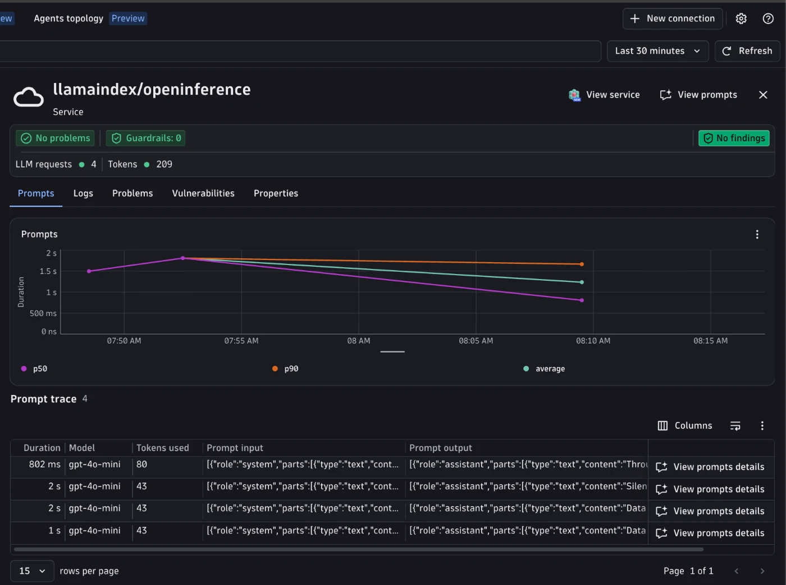

# LlamaIndex + OpenInference Demo



Demonstrates tracing a [LlamaIndex](https://www.llamaindex.ai/) LLM call (Azure OpenAI backend) with Dynatrace via OpenInference instrumentation ([`LlamaIndexInstrumentor`](https://github.com/Arize-ai/openinference/tree/main/python/instrumentation/openinference-instrumentation-llama-index)).
The app sets `OPENINFERENCE_ENABLE_GENAI_SEMCONV=true`, so OpenInference emits OTel GenAI `gen_ai.*` attributes natively; no attribute normalization is needed. OpenInference emits no metrics, so this example uses a Bindplane collector to derive `gen_ai.client.*` metrics from the spans.

---

## Table of contents

- [What you'll build](#what-youll-build)
- [Prerequisites](#prerequisites)
- [Setup](#setup)
- [Run with the Bindplane collector](#run-with-the-bindplane-collector)
- [Visualize in Dynatrace AI Observability](#visualize-in-dynatrace-ai-observability)
- [Native gen_ai attributes](#native-gen_ai-attributes)
- [Metrics](#metrics)
- [Troubleshooting](#troubleshooting)

---

## What you'll build

- A LlamaIndex `AzureOpenAI` chat call that writes a haiku.
- `LlamaIndexInstrumentor` hooks the LlamaIndex instrumentation dispatcher and produces an OpenInference-shaped `LLM` span for the chat call.
- With `OPENINFERENCE_ENABLE_GENAI_SEMCONV=true` (set in `app.py`), the span carries `gen_ai.*` attributes natively.
- Derives `gen_ai.client.operation.duration` and `gen_ai.client.token.usage` from the spans via the Bindplane collector.
- Shows the trace in the Dynatrace AI Observability app with model, token usage, and message content.

---

## Prerequisites

- Python 3.10+
- [uv](https://docs.astral.sh/uv/getting-started/installation/)
- Docker installed and running
- An Azure OpenAI resource (`AZURE_OPENAI_ENDPOINT`, `AZURE_OPENAI_API_KEY`, `AZURE_OPENAI_DEPLOYMENT`)
- Dynatrace tenant with an API token scoped to `openTelemetryTrace.ingest`

---

## Setup

### 1. Create a Dynatrace access token

1. In Dynatrace press `Ctrl+K` and search for **Access tokens**.
2. Create a token with these permissions:
   - `openTelemetryTrace.ingest`
3. Copy the token value.

### 2. Set environment variables

The app and scripts read credentials from environment variables. The easiest way is to create a `.env` file in this directory (the Makefile sources it automatically):

```bash
# .env
DT_ENDPOINT=https://abc12345.live.dynatrace.com
DT_API_TOKEN=dt0c01.****.*****

AZURE_OPENAI_ENDPOINT=https://your-resource.openai.azure.com/
AZURE_OPENAI_API_KEY=**********************
AZURE_OPENAI_DEPLOYMENT=genai-demo                  # optional, defaults to genai-demo
OPENAI_API_VERSION=2024-07-01-preview               # optional, defaults to 2024-07-01-preview
```

> **Note:** `DT_ENDPOINT` is your base tenant URL -- not the `/api/v2/otlp` path. Example: `https://abc12345.live.dynatrace.com`.

### 3. Install dependencies

```bash
make install
```

---

## Run with the Bindplane collector

The [Bindplane Distro for OpenTelemetry (BDOT)](https://github.com/observIQ/bindplane-otel-collector) collector forwards spans unchanged to Dynatrace and derives `gen_ai.client.*` metrics from them. No Dynatrace configuration needed.

```
App  ->  Bindplane collector (metric derivation)  ->  Dynatrace Grail
```

This example pins the collector to `ghcr.io/observiq/bindplane-agent:1.109.0`. The pin means a future version bump surfaces regressions in the e2e test.

The app knows only about `http://localhost:4318` -- it sends spans to the collector, and the collector authenticates with Dynatrace using `DT_ENDPOINT` and `DT_API_TOKEN`.

See [`otel-collector-config.yaml`](otel-collector-config.yaml): the traces pipeline exports spans as-is, and a second branch keeps only LLM spans and feeds the metric connectors (see [Metrics](#metrics)).

### Run it

```bash
# with make (reads .env automatically, starts the collector then runs app.py once)
make run
```

**Useful commands:**

```bash
make logs   # tail collector.log in real time
make stop   # stop and remove the collector container
make request  # re-run the app once against a collector already running
```

---

## Visualize in Dynatrace AI Observability

1. In Dynatrace press `Ctrl+K` and search for **AI Observability**.
2. Your haiku request appears in the Explorer tab, with model, token usage, and cost for the `llamaindex/openinference` service.
3. Open a prompt trace to inspect the request/response content and the agents topology graph.

---


## Native gen_ai attributes

`OPENINFERENCE_ENABLE_GENAI_SEMCONV=true` makes the OpenInference tracer add OTel GenAI attributes (for example `gen_ai.operation.name`, `gen_ai.provider.name`, `gen_ai.request.model`, `gen_ai.usage.input_tokens`, `gen_ai.usage.output_tokens`, `gen_ai.input.messages`, `gen_ai.output.messages`) alongside its own `llm.*` attributes when each span ends. The collector does not rename or map attributes. The exact set of `gen_ai.*` attributes depends on the installed `openinference-instrumentation` package version.

---

### Attributes filled outside OpenInference

| Attribute | How it is set |
|-----------|---------------|
| `gen_ai.conversation.id` | Native: `app.py` wraps each turn in `using_session(conversation_id)`, and OpenInference maps `session.id` to it. |
| `gen_ai.request.temperature` | `app.py` sets it on the LLM span; the LlamaIndex instrumentor records only `LLMMetadata` as invocation parameters, which has no temperature. |
| `gen_ai.system_instructions` | `app.py` sets it on the LLM span; OpenInference keeps the system prompt in `gen_ai.input.messages` only. |
| `gen_ai.response.model` | Collector `transform/response_model` copies `gen_ai.request.model` when unset; the LlamaIndex response payload has no top-level `model` key. |

### Conversations

`app.py` sends two turns of one conversation, each in its own trace, and prints the conversation ID. To continue that conversation, pass it back:

```bash
CONVERSATION_ID=<id printed by the previous run> make request
```

## Metrics

OpenInference is span-only by design (its instrumentors emit no metric instruments), so the collector derives the two metrics the AI Observability app charts from the spans. This populates the cost and latency tiles:

| Metric | Collector connector |
|---|---|
| `gen_ai.client.operation.duration` (s) | `span_metrics` connector, on LLM spans |
| `gen_ai.client.token.usage` (`gen_ai.token.type` = `input`/`output`) | `signal_to_metrics` connector, two sum defs |

Both read the native `gen_ai.usage.input_tokens` / `gen_ai.usage.output_tokens` span attributes. Both metrics use delta temporality; Dynatrace rejects cumulative.

---

## Troubleshooting

**No spans in Dynatrace:**
- Confirm `DT_ENDPOINT` and `DT_API_TOKEN` are correctly set.
- Confirm the token has `openTelemetryTrace.ingest` permission.
- Check collector logs with `make logs` or `docker logs bindplane-otel-collector`.

**Collector crashes on startup:**
- Run `docker ps -a` and `docker logs bindplane-otel-collector` to see the error.
- Confirm Docker is running and port `4318` is free: `lsof -i :4318`.

**Spans visible in Distributed Tracing but not in AI Observability:**
- AI Observability requires `gen_ai.provider.name` (or `gen_ai.system`) to be set on the span.
- Confirm the span carries `gen_ai.*` attributes. If only `llm.*` attributes are present, check that `OPENINFERENCE_ENABLE_GENAI_SEMCONV` is not overridden to `false` in your environment and that `openinference-instrumentation` is recent enough to support it.

**Port conflict:**
- Ensure nothing else is listening on `4318`: `lsof -i :4318`.
