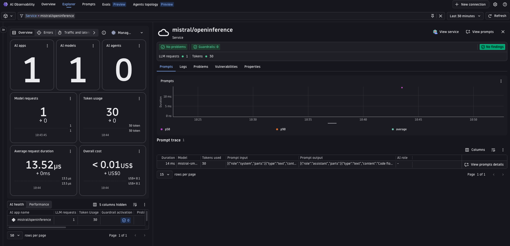
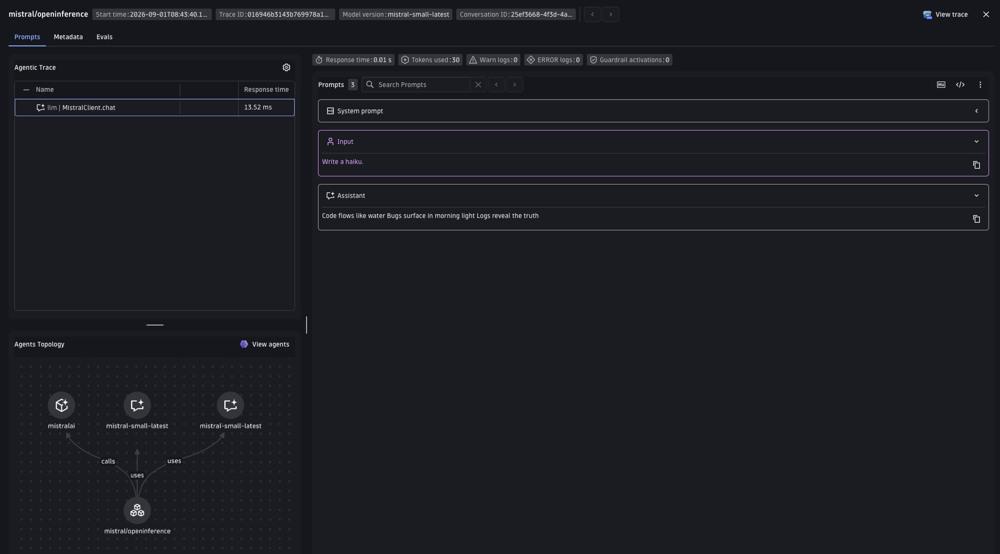

# Mistral + OpenInference + Dynatrace AI Observability

Generate a haiku with Mistral, send the OpenTelemetry trace to Dynatrace, and see it in the **AI Observability** app.
OpenInference uses its own semantic conventions (`llm.model_name`, `llm.token_count.*`, etc.) This example normalizes them into the Dynatrace `gen_ai.*` format with the Bindplane collector's `genainormalizer` processor.

---

## Table of contents

- [What you'll build](#what-youll-build)
- [Prerequisites](#prerequisites)
- [Setup](#setup)
- [Run with the Bindplane collector](#run-with-the-bindplane-collector)
- [Visualize in Dynatrace AI Observability](#visualize-in-dynatrace-ai-observability)
- [Attribute mapping reference](#attribute-mapping-reference)
- [Metrics](#metrics)
- [Known gaps & limitations](#known-gaps--limitations)
- [Troubleshooting](#troubleshooting)

---

## What you'll build

- Calls Mistral to generate a haiku using the `openinference-instrumentation-mistralai` instrumentation library.
- Produces OpenTelemetry traces with OpenInference semantic conventions.
- Normalizes OpenInference attributes to Dynatrace `gen_ai.*` format with the Bindplane collector's `genainormalizer` processor.
- Shows the trace in the Dynatrace AI Observability app with model, token usage, and message content.

Mistral is already demoed via [OneAgent](../oneagent/) auto-instrumentation; this example closes the OpenInference gap for Mistral (see the coverage research in `work/spikes/AI-431-openllmetry-openinference-coverage.md` in the `ai-observability-workspace` repo).

---

## Prerequisites

- A Dynatrace tenant -- start a free trial at https://dt-url.net/trial
- Docker installed and running
- Python 3.10+
- [uv](https://docs.astral.sh/uv/getting-started/installation/)
- A [Mistral API key](https://console.mistral.ai/api-keys)

---

## Setup

### 1. Create a Dynatrace access token

1. In Dynatrace press `Ctrl+K` and search for **Access tokens**.
2. Create a token with these permissions:
   - `openTelemetryTrace.ingest`
3. Copy the token value.

### 2. Set environment variables

The app and scripts read credentials from environment variables. The easiest way is to create a `.env` file in this directory (the Makefile sources it automatically):

```bash
# .env
DT_ENDPOINT=https://abc12345.live.dynatrace.com
DT_API_TOKEN=dt0c01.****.*****

MISTRAL_API_KEY=**********************
MODEL=mistral-small-latest   # optional, defaults to mistral-small-latest
```

> **Note:** `DT_ENDPOINT` is your base tenant URL -- not the `/api/v2/otlp` path. Example: `https://abc12345.live.dynatrace.com`.

If you are not using the Makefile, source the file directly in your shell:

```bash
source .env
```

### 3. Install dependencies

```bash
make install
```

---

## Run with the Bindplane collector

The [Dynatrace Bindplane Distribution of OpenTelemetry Collector (DBDOT)](https://github.com/Dynatrace/dynatrace-bindplane-otel-collector) intercepts spans and normalizes OpenInference attributes to `gen_ai.*` with its built-in `genainormalizer` processor before forwarding to Dynatrace. No Dynatrace configuration needed.

> Why not the [Dynatrace Distribution of the OpenTelemetry Collector](https://docs.dynatrace.com/docs/extend-dynatrace/opentelemetry/collector)? Its manifest does include `genainormalizerprocessor`, but it does not ship a `signal_to_metrics`-equivalent connector, so the token-usage metric (`gen_ai.client.token.usage`) couldn't be derived. That is the same gap that led `openai/openinference`, `aws-bedrock/openinference`, and `langgraph/openinference` to pin the Bindplane collector instead.

```
App  ->  Bindplane collector (genainormalizer + transform)  ->  Dynatrace Grail
```

This example pins the collector to `ghcr.io/dynatrace/dynatrace-bindplane-otel-collector:1.1.2`, matching the version pinned by the [`openai/openinference`](../../openai/openinference/) example. The pin means a future version bump surfaces normalization changes in the e2e test.

The collector needs your Dynatrace credentials because **it is the component that forwards spans to Dynatrace**. The app itself only knows about `http://localhost:4318` -- it sends spans to the collector, and the collector authenticates with Dynatrace using `DT_ENDPOINT` and `DT_API_TOKEN`.

The pipeline runs two processors (see [`otel-collector-config.yaml`](otel-collector-config.yaml)):

1. **`genainormalizer`** (source `openinference`, `remove_originals: true`) maps OpenInference attributes to `gen_ai.*` and reconstructs the flattened `llm.input_messages.N.*` / `llm.output_messages.N.*` attributes into `gen_ai.input.messages` and `gen_ai.output.messages` JSON. `remove_originals` drops the raw `llm.*` attributes so exported spans carry only `gen_ai.*` fields.
2. **`transform/response_model`** mirrors `gen_ai.request.model` to `gen_ai.response.model`, which the AI Observability app requires and OpenInference has no separate field for.

### Step 1 -- Start the collector and run the app

```bash
# with make (reads .env automatically, starts the collector then runs app.py once)
make run
```

Or manually with Docker:

**Linux/macOS:**
```bash
source .env
docker run -d \
  --name bindplane-otel-collector \
  -p 4318:4318 \
  -v $(pwd)/otel-collector-config.yaml:/etc/otel/config.yaml:ro \
  -e DT_ENDPOINT=$DT_ENDPOINT \
  -e DT_API_TOKEN=$DT_API_TOKEN \
  ghcr.io/dynatrace/dynatrace-bindplane-otel-collector:1.1.2
```

**Windows CMD:**
```cmd
set DT_ENDPOINT=https://abc12345.live.dynatrace.com
set DT_API_TOKEN=dt0c01.*****
docker run -d ^
  --name bindplane-otel-collector ^
  -p 4318:4318 ^
  -v %cd%/otel-collector-config.yaml:/etc/otel/config.yaml:ro ^
  -e DT_ENDPOINT=%DT_ENDPOINT% ^
  -e DT_API_TOKEN=%DT_API_TOKEN% ^
  ghcr.io/dynatrace/dynatrace-bindplane-otel-collector:1.1.2
```

The DBDOT image reads its config from `/etc/otel/config.yaml` by default in standalone mode, so no `--config` argument is needed.

What happens:
- The collector listens on port `4318` for incoming OTLP/HTTP spans from the app.
- The `genainormalizer` processor maps OpenInference attributes to `gen_ai.*` and reconstructs the message history.
- The processed spans are forwarded to `$DT_ENDPOINT/api/v2/otlp` authenticated with the API token.

If you started the collector manually, run the app once against it:

```bash
source .env && OTEL_EXPORTER_OTLP_ENDPOINT=http://localhost:4318 OTEL_EXPORTER_OTLP_HEADERS="" python3 app.py
```

**Useful commands:**

```bash
make logs   # tail collector.log in real time
make stop   # stop and remove the collector container

# or manually
docker logs -f bindplane-otel-collector
docker stop bindplane-otel-collector && docker rm bindplane-otel-collector
```

---

## Visualize in Dynatrace AI Observability

1. In Dynatrace press `Ctrl+K` and search for **AI Observability**.
2. Your haiku request appears in the Explorer tab as a span with model name, token usage, and message content.
  
3. Open a span to inspect the full conversation and `gen_ai.*` attributes.
  

---

## Attribute mapping reference

The collector's `genainormalizer` (source `openinference`) applies these translations and reconstructs the full conversation from indexed per-message attributes. This mirrors the mapping documented in the `openinference-to-genai` skill.

| OpenInference source | Dynatrace target |
|---|---|
| `llm.token_count.prompt` | `gen_ai.usage.input_tokens` |
| `llm.token_count.completion` | `gen_ai.usage.output_tokens` |
| `llm.model_name` | `gen_ai.request.model` |
| `llm.provider` / `llm.system` | `gen_ai.provider.name` (both set to `mistralai` by `MistralAIInstrumentor`) |
| `llm.finish_reason` | `gen_ai.response.finish_reasons` (scalar -> `[value]` slice) |
| `llm.invocation_parameters` (JSON: `.temperature`, `.max_tokens`, `.top_p`) | `gen_ai.request.temperature` / `.max_tokens` / `.top_p` |
| `agent.name` | `gen_ai.agent.name` |
| `tool.name` / `tool.description` | `gen_ai.tool.name` / `gen_ai.tool.description` |
| `openinference.span.kind` | `gen_ai.operation.name` (`LLM` -> `chat`) |
| `llm.input_messages.N.*` / `llm.output_messages.N.*` | `gen_ai.input.messages` / `gen_ai.output.messages` |
| _(collector transform)_ | `gen_ai.response.model` (mirrored from `gen_ai.request.model`) |

`session.id` and `user.id` already match the OTel standard and pass through unchanged.

> **Note on request parameters:** `MistralAIInstrumentor` (like `GroqInstrumentor`) never emits discrete `llm.temperature` / `llm.max_tokens` / `llm.top_p` span attributes -- only a single `llm.invocation_parameters` JSON string serializing every `chat.complete()` kwarg, including ones the caller never set (those come through as `""`, not an absent key -- e.g. this demo doesn't pass `top_p`, and it still shows up in the blob as `"top_p": ""`). The collector parses it with OTTL's `ParseJSON` (see `transform/pre_normalize` in [`otel-collector-config.yaml`](otel-collector-config.yaml), which extracts `temperature` only). A naive `fieldsRename` from the flat attribute names -- the pattern this section's table implies and that some sibling OpenInference examples in this repo still use -- never matches anything, since those flat attributes don't exist.

---

## Metrics

OpenInference is span-only by design (its instrumentors emit no metric instruments), so the two metrics the AI Observability app charts must be derived from the spans. The collector does this, so the cost and latency tiles populate:

| Metric | Collector |
|---|---|
| `gen_ai.client.operation.duration` (s) | `span_metrics` connector, on LLM spans |
| `gen_ai.client.token.usage` (`gen_ai.token.type` = `input`/`output`) | `signal_to_metrics` connector, two sum defs |

It reads the normalized `gen_ai.usage.input_tokens` / `gen_ai.usage.output_tokens` (mapped from OpenInference's `llm.token_count.*`). Both metrics use delta temporality -- Dynatrace rejects cumulative.

---

## Known gaps & limitations

### Attributes genainormalizer does not yet map

The `genainormalizer` `openinference` source does not set the following attributes. They are optional for the AI Observability app, and are candidates for upstream contribution to the processor:

- `gen_ai.request.max_tokens` / `gen_ai.request.top_p` (only `temperature` is extracted by `transform/pre_normalize`)
- `gen_ai.response.finish_reasons`

To close these locally, add statements to the `transform` processor in [`otel-collector-config.yaml`](otel-collector-config.yaml).

Prompt caching (`gen_ai.prompt_caching` / `gen_ai.cache.type`) is not applicable here -- the Mistral API does not document prompt caching support today.

### No embeddings coverage

`MistralAIInstrumentor` wraps `mistralai`'s Chat Completion API (`Chat.complete`/`stream`) and Agents API (`Agents.complete`/`stream`) -- both tag the span as `openinference.span.kind = LLM` -- but it does not wrap `mistralai`'s embeddings, classifiers, or OCR endpoints, so the collector does not need to handle `embedding.*` OpenInference attributes -- unlike [`openai/openinference`](../../openai/openinference/), whose `OpenAIInstrumentor` also covers the embeddings endpoint.

---

## Troubleshooting

**No spans in Dynatrace:**
- Confirm `DT_ENDPOINT` and `DT_API_TOKEN` are correctly set.
- Confirm the token has `openTelemetryTrace.ingest` permission.
- Check collector logs with `make logs` or `docker logs bindplane-otel-collector`.

**Collector crashes on startup:**
- Run `docker ps -a` and `docker logs bindplane-otel-collector` to see the error.
- Confirm Docker is running and port `4318` is free: `lsof -i :4318`.

**Spans visible in Distributed Tracing but not in AI Observability:**
- AI Observability requires `gen_ai.provider.name` (or `gen_ai.system`) to be set on the span -- `genainormalizer` sets `gen_ai.provider.name` from `llm.provider`, which `MistralAIInstrumentor` always sets to `mistralai`.
- Confirm the `genainormalizer` processor ran -- the raw `llm.*` attributes should be gone and `gen_ai.*` attributes present in the collector debug output (`make logs`).

**Port conflict:**
- Ensure nothing else is listening on `4318`: `lsof -i :4318`.
