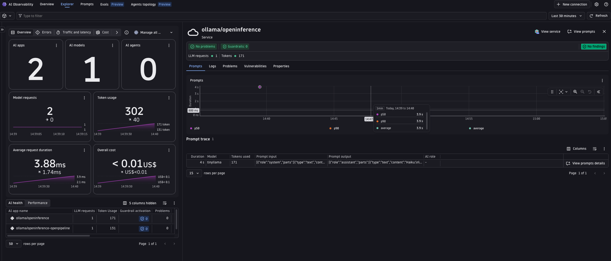
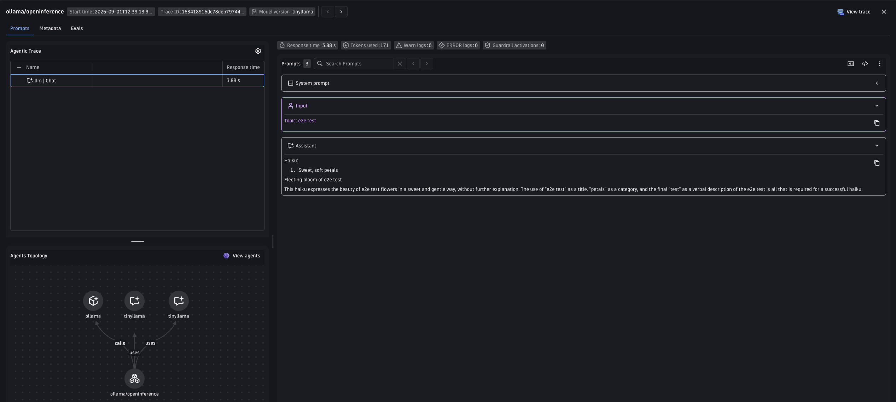

# Ollama + OpenInference Demo

Demonstrates tracing local Ollama chat calls with Dynatrace via OpenInference instrumentation (`OllamaInstrumentor`).
OpenInference uses its own semantic conventions (`llm.model_name`, `llm.token_count.*`, etc.) — this example normalizes them into the Dynatrace `gen_ai.*` format with the Bindplane collector's `gen_ai_normalizer` processor.

Ollama itself runs locally (or on any host you point `OLLAMA_HOST` at) — there is no cloud API key involved, unlike the other provider examples in this repo. See [`ollama/oneagent`](../oneagent/) for the OneAgent-instrumented equivalent of this same app.

---

## Table of contents

- [Prerequisites](#prerequisites)
- [Why the Bindplane collector](#why-the-bindplane-collector)
- [Setup](#setup)
- [Run with the Bindplane collector](#run-with-the-bindplane-collector)
- [Visualize in Dynatrace AI Observability](#visualize-in-dynatrace-ai-observability)
- [Attribute mapping reference](#attribute-mapping-reference)
- [Metrics](#metrics)
- [Known gaps & limitations](#known-gaps--limitations)
- [Troubleshooting](#troubleshooting)

---

## Prerequisites

- Python 3.11+
- [uv](https://docs.astral.sh/uv/getting-started/installation/)
- Docker installed and running
- [Ollama](https://ollama.com/download) installed and running locally, with a model pulled:
  ```bash
  ollama pull llama3.2
  ```
- Dynatrace tenant with an API token scoped to `openTelemetryTrace.ingest`

---

## Why the Bindplane collector

OpenInference uses its own semantic conventions that the Dynatrace AI Observability app does not natively understand, so a collector normalizes them before they reach Dynatrace.

> Why not the [Dynatrace Distribution of the OpenTelemetry Collector](https://docs.dynatrace.com/docs/extend-dynatrace/opentelemetry/collector)? Its manifest does include `genainormalizerprocessor`, but it does not ship a `signal_to_metrics`-equivalent connector, so the token-usage metric (`gen_ai.client.token.usage`) couldn't be derived -- the same gap that led `openai/openinference`, `cohere/openinference`, and `anthropic/openinference` to pin the Bindplane collector instead.

---

## Setup

### 1. Create a Dynatrace access token

1. In Dynatrace press `Ctrl+K` and search for **Access tokens**.
2. Create a token with these permissions:
   - `openTelemetryTrace.ingest`
3. Copy the token value.

### 2. Start Ollama and pull a model

```bash
ollama serve &
ollama pull llama3.2
```

The Ollama server listens on `http://localhost:11434` by default -- set `OLLAMA_HOST` if yours runs elsewhere.

### 3. Set environment variables

The app and scripts read credentials from environment variables. The easiest way is to create a `.env` file in this directory (the Makefile sources it automatically):

```bash
# .env
DT_ENDPOINT=https://abc12345.live.dynatrace.com
DT_API_TOKEN=dt0c01.****.*****

OLLAMA_HOST=http://localhost:11434          # optional, this is the default
MODEL=llama3.2                              # optional, defaults to llama3.2
```

> **Note:** `DT_ENDPOINT` is your base tenant URL -- not the `/api/v2/otlp` path. Example: `https://abc12345.live.dynatrace.com`.

### 4. Install dependencies

```bash
make install
```

---

## Run with the Bindplane collector

The [Dynatrace Bindplane Distribution of OpenTelemetry Collector (DBDOT)](https://github.com/Dynatrace/dynatrace-bindplane-otel-collector) intercepts spans and normalizes OpenInference attributes to `gen_ai.*` with its built-in `gen_ai_normalizer` processor before forwarding to Dynatrace. No Dynatrace configuration needed.

```
App  ->  Bindplane collector (transform + gen_ai_normalizer)  ->  Dynatrace Grail
```

This example pins the collector to `ghcr.io/dynatrace/dynatrace-bindplane-otel-collector:1.1.2`. The pin means a future version bump surfaces normalization changes in the e2e test.

The app knows only about `http://localhost:4318` -- it sends spans to the collector, and the collector authenticates with Dynatrace using `DT_ENDPOINT` and `DT_API_TOKEN`.

The pipeline runs three processors (see [`otel-collector-config.yaml`](otel-collector-config.yaml)):

1. **`transform/pre_normalize`** extracts `temperature`/`num_predict`/`top_p` from the `options` object nested inside `llm.invocation_parameters` before the normalizer deletes that attribute -- see [Attribute mapping reference](#attribute-mapping-reference) for why Ollama needs this extra nesting level.
2. **`gen_ai_normalizer`** (source `openinference`, `remove_originals: true`) maps the remaining OpenInference attributes to `gen_ai.*` -- including `llm.provider` (always `ollama`) to `gen_ai.provider.name`. `remove_originals` drops the raw `llm.*` attributes so exported spans carry only `gen_ai.*` fields.
3. **`transform/response_model`** mirrors `gen_ai.request.model` to `gen_ai.response.model`, which the AI Observability app requires and OpenInference has no separate field for.

### Run it

```bash
# with make (reads .env automatically, starts the collector then runs the app)
make run
```

Then, in a second terminal:

```bash
make request
```

**Useful commands:**

```bash
make logs   # tail collector.log in real time
make stop   # stop and remove the collector container
```

---

## Visualize in Dynatrace AI Observability

1. In Dynatrace press `Ctrl+K` and search for **AI Observability**.
2. Your haiku request appears in the Explorer tab, with model, token usage, and duration for the `ollama/openinference` service.
   
3. Open a prompt trace to inspect the request/response content and the agents topology graph.
   

---

## Attribute mapping reference

The collector's `gen_ai_normalizer` (source `openinference`) applies these translations and reconstructs the full conversation from indexed per-message attributes.

| OpenInference source | Dynatrace target |
|---|---|
| `llm.token_count.prompt` | `gen_ai.usage.input_tokens` |
| `llm.token_count.completion` | `gen_ai.usage.output_tokens` |
| `llm.model_name` | `gen_ai.request.model` |
| `llm.provider` (always `ollama`) | `gen_ai.provider.name` |
| `llm.finish_reason` (from the response's `done_reason`) | `gen_ai.response.finish_reasons` |
| `session.id` | `gen_ai.conversation.id` |
| `openinference.span.kind` | `gen_ai.operation.name` (`LLM`→`chat`, `TOOL`→`execute_tool`, `AGENT`→`invoke_agent`, `RETRIEVER`→`retrieval`) |
| `llm.input_messages.N.*` / `llm.output_messages.N.*` | `gen_ai.input.messages` / `gen_ai.output.messages` |
| `llm.invocation_parameters` (JSON: `options.temperature`, `options.num_predict`, `options.top_p`) | `gen_ai.request.temperature` / `gen_ai.request.max_tokens` / `gen_ai.request.top_p` |
| _(collector `transform`)_ | `gen_ai.response.model` (mirrored from `gen_ai.request.model`) |

`session.id` and `user.id` already match the OTel standard and pass through unchanged.

> **Note on request parameters:** the `ollama` Python client takes `temperature`/`num_predict`/`top_p` as keys of a single `options={...}` dict passed to `chat()`, not as flat keyword arguments like the other provider SDKs in this repo. `OllamaInstrumentor` captures every `chat()` keyword argument other than `messages`/`model`/`tools` verbatim into `llm.invocation_parameters`, so `options` shows up as a nested JSON object one level deeper than e.g. `cohere/openinference`'s flat `{"temperature": ..., "max_tokens": ...}`. The collector's `transform/pre_normalize` step accounts for this extra nesting level. Ollama has no `max_tokens` option; `num_predict` (the number of tokens to predict) is its equivalent, mapped to the standard `gen_ai.request.max_tokens`. This demo's `main.py` passes `temperature` and `num_predict` on every request; `top_p` is not passed and stays unset.

---

## Metrics

OpenInference is span-only by design (its instrumentors emit no metric instruments), so the two metrics the AI Observability app charts must be derived from the spans. The collector derives them:

| Metric | Collector component |
|---|---|
| `gen_ai.client.operation.duration` (s) | `span_metrics` connector, on LLM spans |
| `gen_ai.client.token.usage` (`gen_ai.token.type` = `input`/`output`) | `signal_to_metrics` connector, two sum defs |

Both read the normalized `gen_ai.usage.input_tokens` / `gen_ai.usage.output_tokens` (mapped from OpenInference's `llm.token_count.*`, in turn taken from Ollama's own `prompt_eval_count`/`eval_count` response fields). Both metrics use delta temporality -- Dynatrace rejects cumulative.

---

## Known gaps & limitations

### Not instrumented

`OllamaInstrumentor` wraps only `ollama.chat` / `Client.chat` / `AsyncClient.chat`. Calls to `generate`, `embed`, or `embeddings` produce no spans -- there is no equivalent of the embedding processors present in `openai/openinference`'s pipeline to drop here, because Ollama's own client methods for those calls are simply untraced.

### Attributes gen_ai_normalizer does not map without help

The `gen_ai_normalizer` `openinference` source does not parse `llm.invocation_parameters` at all -- both `gen_ai.request.temperature`, `gen_ai.request.max_tokens`, and `gen_ai.request.top_p` need the extra `transform/pre_normalize` step in [`otel-collector-config.yaml`](otel-collector-config.yaml) (see the note under [Attribute mapping reference](#attribute-mapping-reference)).

Prompt caching (`gen_ai.prompt_caching` / `gen_ai.cache.type`) is not applicable here -- Ollama's chat API has no prompt-caching concept.

---

## Troubleshooting

**No spans in Dynatrace:**
- Confirm `DT_ENDPOINT` and `DT_API_TOKEN` are correctly set.
- Confirm the token has `openTelemetryTrace.ingest` permission.
- Confirm Ollama is reachable at `OLLAMA_HOST` and the model in `MODEL` has been pulled (`ollama list`).
- Check collector logs with `make logs` or `docker logs bindplane-otel-collector-ollama`.

**Collector crashes on startup:**
- Run `docker ps -a` and `docker logs bindplane-otel-collector-ollama` to see the error.
- Confirm Docker is running and port `4318` is free: `lsof -i :4318`.

**Spans visible in Distributed Tracing but not in AI Observability:**
- AI Observability requires `gen_ai.provider.name` (or `gen_ai.system`) to be set on the span.
- Confirm the `gen_ai_normalizer` processor ran -- the raw `llm.*` attributes should be gone and `gen_ai.*` attributes present in the collector debug output (`make logs`).

**Port conflict:**
- Ensure nothing else is listening on `4318`: `lsof -i :4318`.

**`ollama.ResponseError: model not found` or connection refused:**
- Run `ollama pull $MODEL` (default `llama3.2`) and confirm `ollama serve` is running and reachable at `OLLAMA_HOST`.
