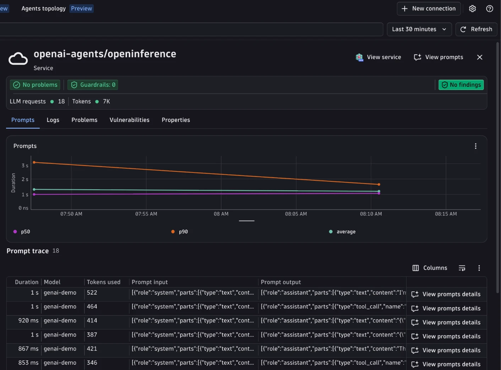

# OpenAI Agents SDK + OpenInference + Dynatrace AI Observability



Instrument an [OpenAI Agents SDK](https://openai.github.io/openai-agents-python/) multi-agent app with OpenInference and send traces to Dynatrace AI Observability.
This is the same airline customer-service app as [`openai-agents/opentelemetry`](../opentelemetry/) (triage, FAQ, seat booking, flight status, and cancellation agents with tools, handoffs, and input guardrails), instrumented with [`openinference-instrumentation-openai-agents`](https://github.com/Arize-ai/openinference/tree/main/python/instrumentation/openinference-instrumentation-openai-agents) instead of Traceloop.
This example enables `OPENINFERENCE_ENABLE_GENAI_SEMCONV=true` (set in `api.py`), so OpenInference emits `gen_ai.*` attributes natively and no downstream attribute normalization is needed.
A [Bindplane OTel collector](https://github.com/observIQ/bindplane-agent) is still used to derive metrics, because OpenInference instrumentors are span-only.

## What you'll build

- A FastAPI server on port `8000` exposing `POST /chat` (accepts `{"topic": "..."}` or `{"message": "...", "conversation_id": "..."}`).
- OpenInference spans for every agent run, LLM call, tool call, handoff, and guardrail.
- `session.id` set per conversation with `using_session`, so all turns of a conversation share one `gen_ai.conversation.id` (OpenInference maps `session.id` to it natively).
- Derived `gen_ai.client.operation.duration` and `gen_ai.client.token.usage` metrics, computed in the collector from the spans (OpenInference emits spans only).

## Prerequisites

- A Dynatrace tenant (start a free trial at https://dt-url.net/trial)
- A Dynatrace access token with `openTelemetryTrace.ingest` and `metrics.ingest`
- Python 3.10+ and [uv](https://docs.astral.sh/uv/getting-started/installation/)
- Docker (to run the Bindplane collector)
- An Azure OpenAI endpoint, key, and deployment

## Run the example

```bash
cp .env.sample .env   # then fill in the values
make install
make run              # starts the collector, then the app on port 8000
make request          # in a second terminal
```

`make help` lists all targets. `make stop` removes the collector container.

## Visualize in Dynatrace

Open the [AI Observability app](https://docs.dynatrace.com/docs/shortlink/app-ai-observability) and look for the `openai-agents/openinference` service. Each `/chat` request is one trace; agent, LLM, and tool spans appear as children of the `/chat` span.


## How it works

- `api.py` sets `OPENINFERENCE_ENABLE_GENAI_SEMCONV=true`, creates a `TracerProvider` that exports OTLP/HTTP to `OTEL_EXPORTER_OTLP_ENDPOINT`, then calls `OpenAIAgentsInstrumentor().instrument(...)`. The instrumentor registers an Agents SDK trace processor that turns SDK spans into OpenTelemetry spans and replaces the default export to the OpenAI tracing backend.
- `main.py` defines the agents, tools, handoffs, and guardrails. Every agent uses `ModelSettings(temperature=0.7)`, which OpenInference records as `gen_ai.request.temperature`.
- `/chat` reuses a client-supplied `conversation_id` (or generates a UUID when absent) and returns it, so a client can continue the conversation. `make request` sends two turns with the same id; each turn is its own trace.
- `otel-collector-config.yaml` derives the GenAI client metrics from LLM spans with the `span_metrics` and `signal_to_metrics` connectors (`gen_ai.client.token.usage` carries `gen_ai.token.type` `input`/`output`). It also fills two attributes the instrumentation does not emit:
  - `gen_ai.response.model`: the Agents SDK chat-completions span does not keep the response model, so the collector copies `gen_ai.request.model` when it is unset.
  - `gen_ai.system_instructions`: OpenInference keeps the agent instructions as the leading `system` message in `gen_ai.input.messages`; the collector copies that message's parts.

See [Get started with OpenInference](https://docs.dynatrace.com/docs/observe/dynatrace-for-ai-observability/get-started/openinference) for more details.
