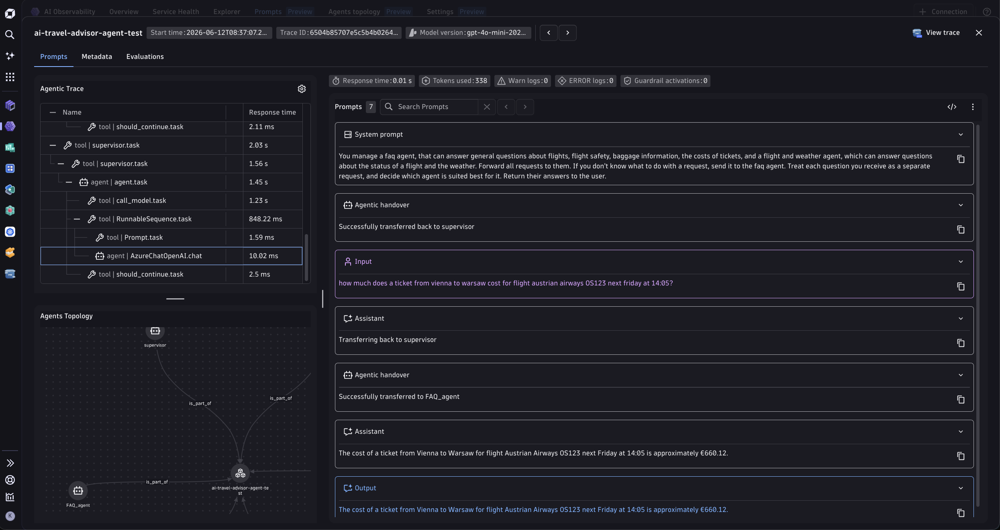

## OpenAI Agent SDK


This example contains a demo of a Customer Service Agent interface built on top of the [OpenAI Agents SDK](https://openai.github.io/openai-agents-python/). The original example code can be found in the [openai-cs-agents-demo](https://github.com/openai/openai-cs-agents-demo) GitHub repo.



## Dynatrace Instrumentation

> [!TIP]
> For detailed setup instructions, configuration options, and advanced use cases, please refer to the [Get Started Docs](https://docs.dynatrace.com/docs/shortlink/ai-ml-get-started).


This demo uses the OpenTelemetry project's own instrumentation for the Agents SDK, [`opentelemetry-instrumentation-openai-agents-v2`](https://github.com/open-telemetry/opentelemetry-python-contrib/tree/main/instrumentation-genai/opentelemetry-instrumentation-openai-agents-v2), on top of the plain OpenTelemetry SDK. No vendor SDK is involved.

Setup lives in [`api.py`](./api.py):

```python
token = os.environ.get("DT_API_TOKEN") or read_secret("dynatrace_otel")
headers = {"Authorization": f"Api-Token {token}"}
_dt_base = os.environ.get("DT_ENDPOINT", "").rstrip("/")
OTLP_ENDPOINT = f"{_dt_base}/api/v2/otlp"

_tracer_provider = TracerProvider(resource=Resource.create({"service.name": "openai-cs-agents"}))
_tracer_provider.add_span_processor(
    BatchSpanProcessor(OTLPSpanExporter(endpoint=f"{OTLP_ENDPOINT}/v1/traces", headers=headers))
)
trace.set_tracer_provider(_tracer_provider)

OpenAIAgentsInstrumentor().instrument(
    tracer_provider=_tracer_provider,
    system="azure.ai.openai",
    capture_message_content="span_only",
)
```

`system` sets `gen_ai.provider.name` (the default is `openai`), and `capture_message_content="span_only"` puts prompts and completions on span attributes, where Dynatrace reads them.

The token is read from the `DT_API_TOKEN` environment variable first, falling back to `/etc/secrets/dynatrace_otel` for Kubernetes deployments.

### Derived agent metrics

`make run-collector` starts the app behind a local OpenTelemetry Collector (`otel-collector-config.yaml`) that derives three GenAI semconv metrics from the spans, with no change to the agent code:

| Metric | Derived from |
|---|---|
| `gen_ai.invoke_agent.duration` | the agent span (`gen_ai.operation.name = invoke_agent`) |
| `gen_ai.execute_tool.duration` | the function-tool span (`gen_ai.operation.name = execute_tool`) |
| `gen_ai.invoke_workflow.duration` | the per-trace root span (`Agent Workflow`) |

The instrumentation already sets the spec operation name on the agent and tool spans. The root workflow span is the gap: it is tagged `invoke_agent` like the agent spans below it, so `transform/operation_name` re-tags the `SERVER`-kind root as `invoke_workflow`. The same transform removes the `unknown` operation name the instrumentation puts on the SDK's task and turn spans, which have no GenAI semconv equivalent.

The app itself exports traces and logs only. The `gen_ai.client.*` token and duration metrics are not emitted, because the instrumentation does not produce them for the Agents SDK.

All three are Histograms in seconds, exported with delta temporality because Dynatrace OTLP metric ingest rejects cumulative metrics. The collector also renames `service.name` to `openai-cs-agents-collector`, so a collector run stays distinguishable from a direct-export run in Dynatrace.

When `OTEL_ENDPOINT` is set (which `make run-collector` does), traces, metrics and logs all go to the collector and the Dynatrace credentials live only in the collector config.

## How to use

### Prerequisites

- Python 3.11+
- [uv](https://docs.astral.sh/uv/getting-started/installation/)
- Azure OpenAI resource with a `gpt-4o` deployment
- A Dynatrace environment with an API token scoped to `openTelemetryTrace.ingest` and `metrics.ingest`

### Configure environment variables

```bash
# Dynatrace
export DT_ENDPOINT=https://<YOUR_ENV_ID>.live.dynatrace.com
export DT_API_TOKEN=dt0c01.<YOUR_TOKEN>

# Azure OpenAI
export AZURE_OPENAI_API_KEY=<YOUR_KEY>
export AZURE_OPENAI_API_VERSION=2024-08-01-preview
export AZURE_OPENAI_ENDPOINT=https://<YOUR_RESOURCE>.openai.azure.com/
export AZURE_OPENAI_DEPLOYMENT=gpt-4o
```

### Install and run

```bash
make install         # install Python dependencies
make run             # start the backend on port 8000, exporting straight to Dynatrace
make run-collector   # or: start it behind a collector that derives the agent metrics
make request         # send a test question (in a second terminal)
```

The backend API is available at [http://localhost:8000](http://localhost:8000). A Next.js frontend is available in the `ui/` folder:

```bash
cd ui && npm install && npm run dev
```

The frontend will be available at [http://localhost:3000](http://localhost:3000).

