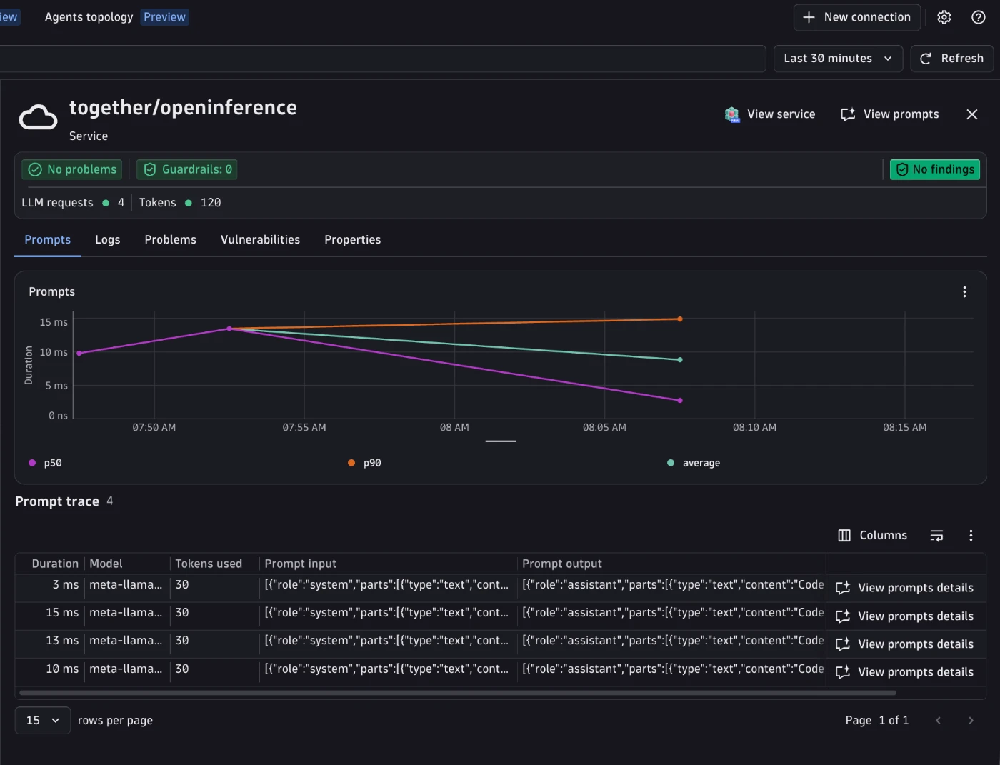

# Together AI + OpenInference + Dynatrace AI Observability



Generate a haiku with Together AI, send the OpenTelemetry trace to Dynatrace, and see it in the **AI Observability** app.
The app sets `OPENINFERENCE_ENABLE_GENAI_SEMCONV=true`, so OpenInference emits OTel GenAI semantic-convention attributes (`gen_ai.*`) natively. No attribute normalization is needed; the collector only derives the `gen_ai.client.*` metrics.

---

## Table of contents

- [What you'll build](#what-youll-build)
- [Prerequisites](#prerequisites)
- [Setup](#setup)
- [Bindplane collector](#bindplane-collector)
- [Visualize in Dynatrace AI Observability](#visualize-in-dynatrace-ai-observability)
- [Metrics](#metrics)
- [Known gaps & limitations](#known-gaps--limitations)
- [Troubleshooting](#troubleshooting)

---

## What you'll build

- Runs a 2-turn haiku conversation with Together AI using the `openinference-instrumentation-together` instrumentation library.
- Produces OpenTelemetry traces with native `gen_ai.*` attributes (enabled by `OPENINFERENCE_ENABLE_GENAI_SEMCONV=true` in [`app.py`](app.py)).
- Derives `gen_ai.client.operation.duration` and `gen_ai.client.token.usage` from the spans in the Bindplane collector.
- Shows the trace in the Dynatrace AI Observability app with model, token usage, and message content.

Together AI exposes an OpenAI-compatible chat completions API for open models (Llama, Qwen, DeepSeek, and more). `TogetherInstrumentor` wraps the native `together` Python SDK (v2+).

> `OPENINFERENCE_ENABLE_GENAI_SEMCONV` depends on OpenInference package behavior: it is implemented in `openinference-instrumentation` 0.1.71+, which `openinference-instrumentation-together` 0.1.12 requires. The OpenInference `llm.*` attributes are still emitted alongside `gen_ai.*`.

---

## Prerequisites
- A Dynatrace tenant -- start a free trial at https://dt-url.net/trial
- Docker installed and running
- Python 3.10+
- [uv](https://docs.astral.sh/uv/getting-started/installation/)
- A [Together AI API key](https://api.together.ai/settings/api-keys)

---

## Setup

### 1. Create a Dynatrace access token

1. In Dynatrace press `Ctrl+K` and search for **Access tokens**.
2. Create a token with these permissions:
   - `openTelemetryTrace.ingest`
3. Copy the token value.

### 2. Set environment variables

The app and scripts read credentials from environment variables. The easiest way is to create a `.env` file in this directory (the Makefile sources it automatically):

```bash
# .env
DT_ENDPOINT=https://abc12345.live.dynatrace.com
DT_API_TOKEN=dt0c01.****.*****

TOGETHER_API_KEY=**********************
MODEL=meta-llama/Llama-3.3-70B-Instruct-Turbo   # optional, defaults to meta-llama/Llama-3.3-70B-Instruct-Turbo
```

> **Note:** `DT_ENDPOINT` is your base tenant URL -- not the `/api/v2/otlp` path. Example: `https://abc12345.live.dynatrace.com`.

If you are not using the Makefile, source the file directly in your shell:

```bash
source .env
```

### 3. Install dependencies

```bash
make install
```

---

## Bindplane collector

The [Dynatrace Bindplane Distribution of OpenTelemetry Collector (DBDOT)](https://github.com/Dynatrace/dynatrace-bindplane-otel-collector) forwards the spans to Dynatrace and derives the `gen_ai.client.*` metrics from them. No Dynatrace configuration needed. OpenInference is span-only, so the metrics the AI Observability app charts must be derived from spans.

> Why not the [Dynatrace Distribution of the OpenTelemetry Collector](https://docs.dynatrace.com/docs/extend-dynatrace/opentelemetry/collector)? It does not ship a `signal_to_metrics`-equivalent connector, so the token-usage metric (`gen_ai.client.token.usage`) couldn't be derived.

```
App (native gen_ai.*)  ->  Bindplane collector (metrics)  ->  Dynatrace Grail
```

This example pins the collector to `ghcr.io/dynatrace/dynatrace-bindplane-otel-collector:1.1.2`, matching the version pinned by the [`openai/openinference`](../../openai/openinference/) example. The pin means a future version bump surfaces regressions in the e2e test.

The collector needs your Dynatrace credentials because **it is the component that forwards spans to Dynatrace**. The app itself only knows about `http://localhost:4318` -- it sends spans to the collector, and the collector authenticates with Dynatrace using `DT_ENDPOINT` and `DT_API_TOKEN`.

### Step 1 -- Start the collector and run the app

```bash
# with make (reads .env automatically, starts the collector then runs app.py once)
make run
```

Or manually with Docker:

**Linux/macOS:**
```bash
source .env
docker run -d \
  --name bindplane-otel-collector \
  -p 4318:4318 \
  -v $(pwd)/otel-collector-config.yaml:/etc/otel/config.yaml:ro \
  -e DT_ENDPOINT=$DT_ENDPOINT \
  -e DT_API_TOKEN=$DT_API_TOKEN \
  ghcr.io/dynatrace/dynatrace-bindplane-otel-collector:1.1.2
```

**Windows CMD:**
```cmd
set DT_ENDPOINT=https://abc12345.live.dynatrace.com
set DT_API_TOKEN=dt0c01.*****
docker run -d ^
  --name bindplane-otel-collector ^
  -p 4318:4318 ^
  -v %cd%/otel-collector-config.yaml:/etc/otel/config.yaml:ro ^
  -e DT_ENDPOINT=%DT_ENDPOINT% ^
  -e DT_API_TOKEN=%DT_API_TOKEN% ^
  ghcr.io/dynatrace/dynatrace-bindplane-otel-collector:1.1.2
```

The DBDOT image reads its config from `/etc/otel/config.yaml` by default in standalone mode, so no `--config` argument is needed.

What happens:
- The collector listens on port `4318` for incoming OTLP/HTTP spans from the app.
- A second pipeline branch keeps only LLM spans and feeds the metric connectors.
- Spans and derived metrics are forwarded to `$DT_ENDPOINT/api/v2/otlp` authenticated with the API token.

If you started the collector manually, run the app once against it:

```bash
source .env && OTEL_EXPORTER_OTLP_ENDPOINT=http://localhost:4318 OTEL_EXPORTER_OTLP_HEADERS="" python3 app.py
```

**Useful commands:**

```bash
make logs   # tail collector.log in real time
make stop   # stop and remove the collector container

# or manually
docker logs -f bindplane-otel-collector
docker stop bindplane-otel-collector && docker rm bindplane-otel-collector
```

---

## Visualize in Dynatrace AI Observability

1. In Dynatrace press `Ctrl+K` and search for **AI Observability**.
2. Your haiku request appears in the Explorer tab, with model, token usage, and cost for the `together/openinference` service.
3. Open a prompt trace to inspect the request/response content and the agents topology graph.

---


## Metrics

OpenInference is span-only by design (its instrumentors emit no metric instruments), so the two metrics the AI Observability app charts must be derived from the spans. The collector does this, so the cost and latency tiles populate:

| Metric | Collector |
|---|---|
| `gen_ai.client.operation.duration` (s) | `span_metrics` connector, on LLM spans |
| `gen_ai.client.token.usage` (`gen_ai.token.type` = `input`/`output`) | `signal_to_metrics` connector, two sum defs |

The collector reads the native `gen_ai.usage.input_tokens` / `gen_ai.usage.output_tokens`. Both metrics use delta temporality -- Dynatrace rejects cumulative.

---

## Conversation attributes

- `gen_ai.conversation.id`: each run is one conversation of two turns (two traces). The id comes from `CONVERSATION_ID` when set, otherwise a new UUID is generated and printed. It is set with OpenInference `using_session`, which maps `session.id` to `gen_ai.conversation.id`. Continue a conversation with:

  ```bash
  make request CONVERSATION_ID=my-conversation-1
  make request CONVERSATION_ID=my-conversation-1
  ```

- `gen_ai.request.temperature`: the app passes `temperature=0.7`; OpenInference maps it from the invocation parameters.
- `gen_ai.system_instructions`: OpenInference does not emit it, so a small span processor in [`app.py`](app.py) sets it on the LLM span as a JSON array of parts.

---

## Known gaps & limitations

### No embeddings coverage

`TogetherInstrumentor` only wraps Together AI's `chat.completions` endpoint (not its embeddings, images, or audio endpoints) -- unlike [`openai/openinference`](../../openai/openinference/), whose `OpenAIInstrumentor` also covers the embeddings endpoint.

---

## Troubleshooting

**No spans in Dynatrace:**
- Confirm `DT_ENDPOINT` and `DT_API_TOKEN` are correctly set.
- Confirm the token has `openTelemetryTrace.ingest` permission.
- Check collector logs with `make logs` or `docker logs bindplane-otel-collector`.

**Collector crashes on startup:**
- Run `docker ps -a` and `docker logs bindplane-otel-collector` to see the error.
- Confirm Docker is running and port `4318` is free: `lsof -i :4318`.

**Spans visible in Distributed Tracing but not in AI Observability:**
- AI Observability requires `gen_ai.provider.name` (or `gen_ai.system`) on the span. With `OPENINFERENCE_ENABLE_GENAI_SEMCONV=true`, OpenInference sets it from `llm.provider` (`together`).
- Check the console span output of `app.py`: `gen_ai.*` attributes should be present. If only `llm.*` attributes appear, the installed `openinference-instrumentation` is older than 0.1.71.

**Port conflict:**
- Ensure nothing else is listening on `4318`: `lsof -i :4318`.
